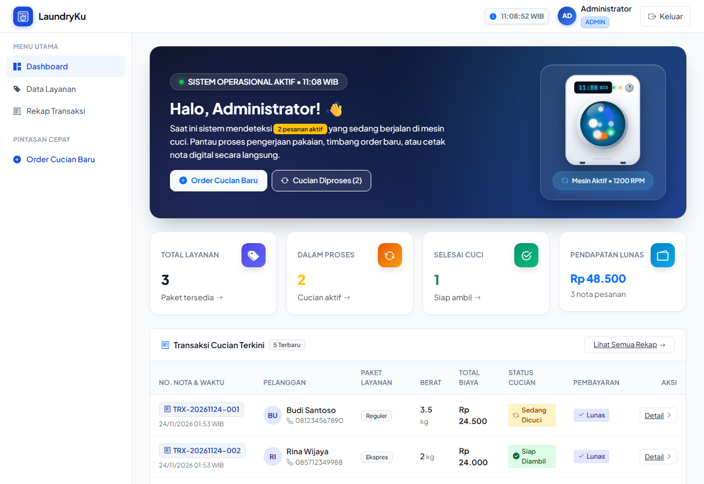
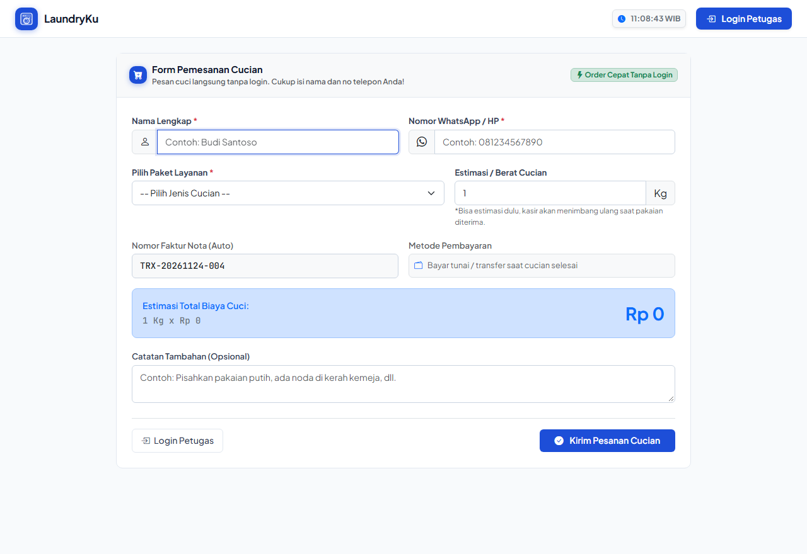
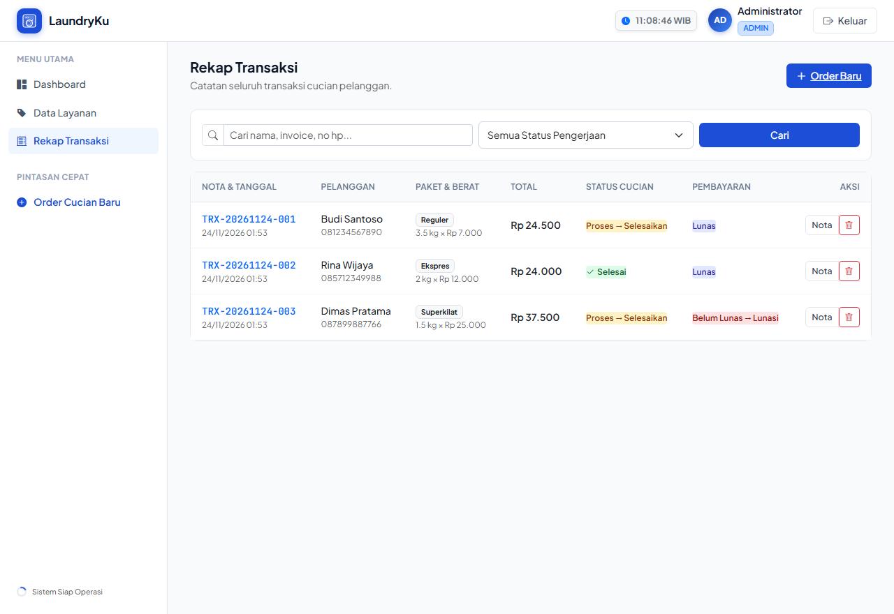
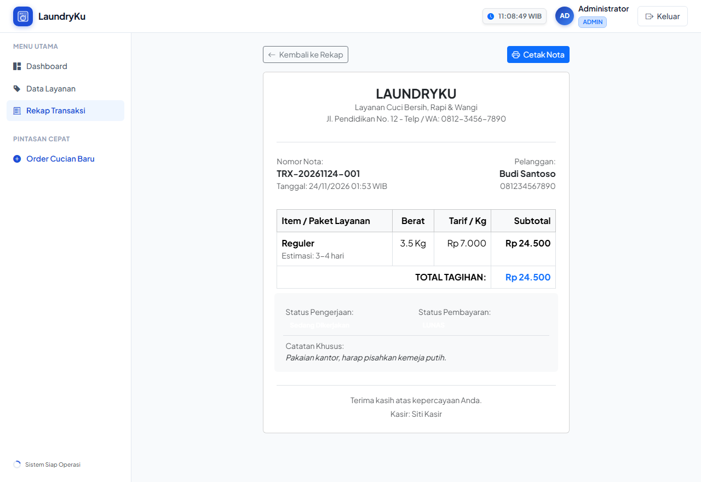
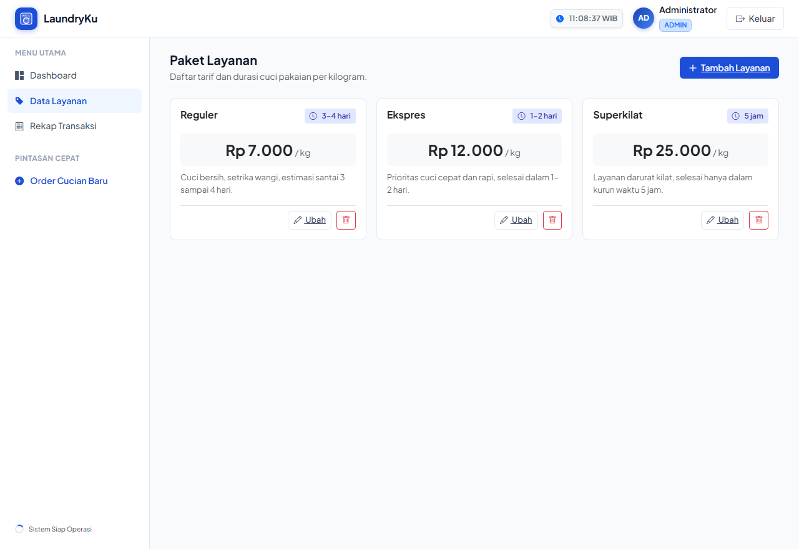

# 🧺 LaundryKu - Aplikasi Sistem Informasi Manajemen Laundry Kiloan

> **Proyek Asesmen Akhir Semester (ASAS) Konsentrasi Keahlian Rekayasa Perangkat Lunak (RPL) Kelas XII**  
> **Nama Pengembang:** Septian Aldis Rizki Ramadhan  
> **Kelas:** XII RPL 1  
> **Teknologi:** PHP 8.2+ • Laravel 11 • SQLite / MySQL • Bootstrap 5 • Vanilla JS Animations  

---

## 🌟 Fitur Utama Aplikasi

1. **Alur Pelayanan Praktis Tanpa Login (Public Order):**
   - Customer langsung melihat formulir pemesanan saat membuka halaman utama tanpa perlu registrasi/login.
   - Cukup menginput Nama Lengkap, Nomor HP/WhatsApp aktif, memilih paket cucian, dan memasukkan estimasi berat cucian.
   - Perhitungan total biaya otomatis secara real-time via JavaScript interaktif.
   - Otomatis mencetak nomor nota digital resmi (`TRX-YYYYMMDD-XXXX`).

2. **Pembagian Hak Akses Role (RBAC):**
   - **Kasir:** Melayani customer, mencatat transaksi, memperbarui status cucian (*Proses/Pending &rarr; Selesai/Success*), dan memperbarui status pembayaran (*Belum Lunas &rarr; Lunas*). Akses modifikasi paket layanan dikunci (403 Forbidden).
   - **Admin:** Memiliki wewenang penuh (Superuser) untuk **CRUD Data Layanan** (Tambah paket, ubah tarif per kg & durasi pengerjaan, hapus layanan), pemantauan finansial omset toko, dan manajemen seluruh data transaksi.

3. **Dashboard Modern & Animasi Interaktif Mesin Cuci:**
   - Hero banner bergaya modern SaaS dengan pod showcase kaca buram (*frosted glass*).
   - Animasi mesin cuci berputar: drum spin, pakaian warna-warni yang bergulung, gelembung busa sabun, dan efek getaran mekanis (*rumble vibration*).
   - Jam digital real-time sinkron zona waktu **WIB (Asia/Jakarta)** yang berdetik langsung di dashboard dan topbar.
   - Kartu metrik statistik interaktif dengan ikon 3D squircle gradient.
   - Tabel riwayat transaksi terkini dengan avatar inisial pelanggan dan penanda status live.

4. **Desain Responsif Multi-Device:**
   - Diuji dan dioptimalkan secara presisi untuk 3 ukuran layar: **Desktop (1280px)**, **Tablet (768px)**, dan **Smartphone / HP (375px)**.

5. **Pengujian Otomatis (Automated Testing):**
   - Dilengkapi 9 skenario unit & feature testing (49 assertions) menggunakan PHPUnit untuk memastikan seluruh alur transaksi dan proteksi role berjalan 100% valid.

---

## 🖼️ Tampilan Antarmuka (Preview)

| Halaman | Tampilan Layar |
| :--- | :--- |
| **Dashboard Operasional** |  |
| **Formulir Order Baru (Tanpa Login)** |  |
| **Rekapitulasi Transaksi** |  |
| **Cetak Lembar Nota** |  |
| **CRUD Master Layanan** |  |

---

## 🔑 Akun Demo Pengujian

| Peran (Role) | Email | Password | Wewenang |
| :--- | :--- | :--- | :--- |
| **Admin** | `admin@laundry.test` | `admin123` | Akses penuh CRUD Layanan & monitoring keuangan |
| **Kasir** | `kasir@laundry.test` | `kasir123` | Input order, update status proses & status bayar |

---

## 🚀 Panduan Menjalankan Aplikasi

1. Clone repositori ini:
   ```bash
   git clone https://github.com/Skymystogan77/asas-laundry.git
   cd asas-laundry
   ```

2. Instal dependensi Composer:
   ```bash
   composer install
   ```

3. Siapkan file konfigurasi environment:
   ```bash
   copy .env.example .env
   php artisan key:generate
   ```

4. Jalankan migrasi dan seeder database pengujian:
   ```bash
   php artisan migrate:fresh --seed
   ```

5. Jalankan unit test untuk verifikasi:
   ```bash
   php vendor/phpunit/phpunit/phpunit
   ```

6. Jalankan server lokal:
   ```bash
   php artisan serve
   ```
   Akses melalui browser di: `http://127.0.0.1:8000`

---

## 📁 Dokumen Laporan Tugas

Seluruh dokumen pelaporan tugas dalam format `.docx` tersimpan pada direktori `dokumen_laporan/`:
1. `1_Penjelasan_Migration_Database.docx`
2. `2_Login_Register_dan_Perbedaan_Role.docx`
3. `3_CRUD_Layanan.docx`
4. `4_Order_dan_Rekap_Order.docx`
5. `5_Log_Penggunaan_AI.docx`
6. `DOKUMEN_LENGKAP_SEMUA_TUGAS_ASAS.docx` (Bundel Lengkap)
